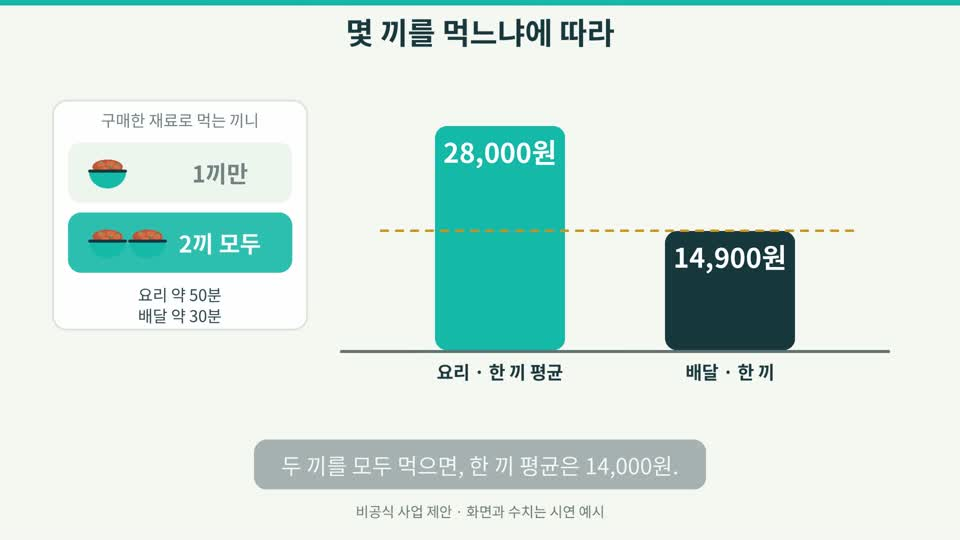
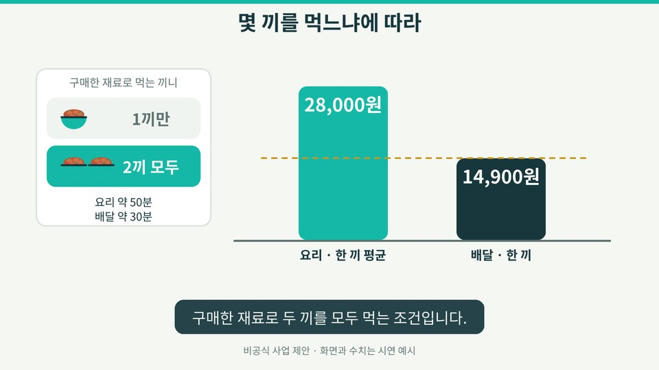
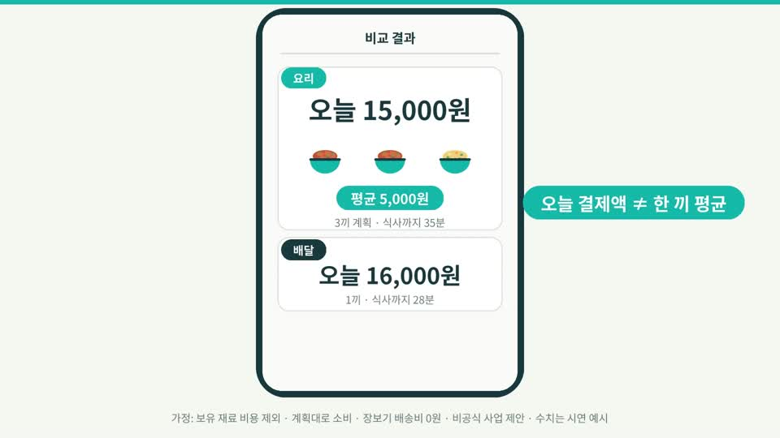
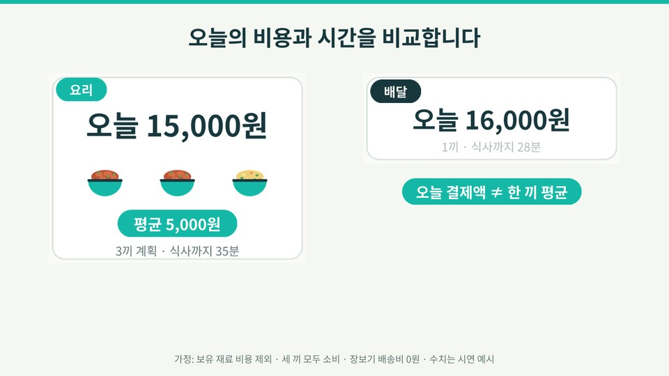
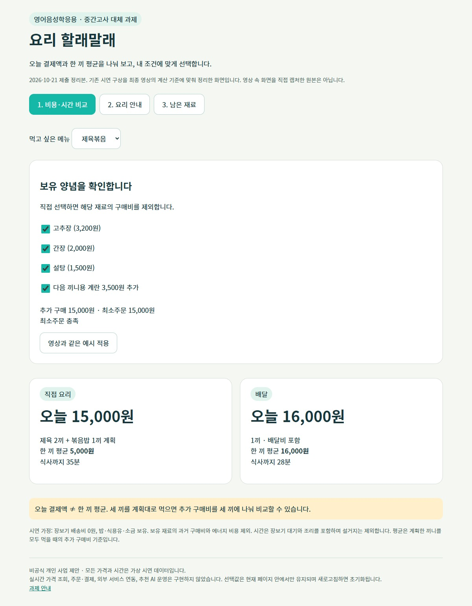

# 요리 할래말래
## 사업 구상 및 영상 제작 보고서
영어음성학응용 | 2026학년도 2학기 중간고사 대체 과제
고려대학교 영어영문학과 | 2023130847 | 이승목
정리일: 2026년 10월 21일 / 제출 마감: 10월 29일 23:59
저장소: https://github.com/lees1289-glitch/2026Fall/tree/main/midterm

### 프로젝트 개요
먹고 싶은 메뉴와 집에 있는 재료를 바탕으로 직접 요리와 배달의 오늘 결제액, 한 끼 평균 구매비, 식사까지 걸리는 시간을 비교하는 서비스 구상입니다. 요리를 항상 정답으로 제시하지 않고, 그날의 식사 계획과 조리 부담에 맞는 선택을 돕습니다.

모션그래픽은 비교 원리와 사업 계획을 설명하고, AI 영화는 혼자 사는 청년의 선택 과정을 생활 장면으로 보여 줍니다. 두 영상은 각각 90초이며, 이 보고서에는 사업 내용과 제작 방법, 최종 구성, 제공된 생성 프롬프트를 함께 수록했습니다.

현재 완성 범위는 시연용 HTML, 모션그래픽, AI 영화입니다. 한국어 설명 문장은 격식체로 통일했습니다. 실제 가격 수집, 주문·결제, 외부 플랫폼 연동, 추천 AI 운영은 구현하지 않았습니다. 금액과 시간은 모두 가상 시연 데이터이며 실제 판매가·절약액을 보장하지 않습니다. 특정 배달 플랫폼의 공식 서비스가 아닌 개인 사업 제안입니다.

---PAGE---
## 1. 공모전 준비에서 사업 구상으로
이 아이디어는 KOSAC 공모전을 준비하면서 혼자 생활하는 2030세대의 식비와 식사 선택 문제를 고민한 데서 출발했습니다. 이번 과제에서는 그 문제의식을 개인 사업 구상으로 발전시켰습니다. 공모전 공식 요강 원문은 이번 제출 묶음에 포함되어 있지 않아 공식 과제명, 일정, 후원사에 관한 설명은 생략합니다.

처음에는 배달을 더 저렴하게 이용하는 방법을 생각했지만, 한 끼의 부담은 배달 가격만으로 설명되지 않았습니다. 요리는 재료를 여러 끼 분량으로 구매해야 할 수 있고, 최소주문 금액과 보유 양념에 따라 오늘 지출이 달라집니다. 배달은 한 끼 비용이 높아도 기다리거나 조리하는 부담을 줄이는 선택이 될 수 있습니다.

이에 문제의 초점을 저렴한 배달 이용에서 그날의 조건에 맞는 요리·배달 선택으로 전환했습니다. 이 문제의식을 서비스의 비교 화면과 두 영상에 공통으로 적용했습니다.

### 대상과 해결하려는 문제
대상은 혼자 생활하면서 식비와 시간을 함께 고려하는 2030세대입니다. 재료 가격, 보유 재료, 구매 후 먹을 끼니, 최소주문 조건을 따로 확인해야 하는 불편을 줄이는 것을 목표로 합니다. 시장 규모나 이용자 수, 실제 절약률은 조사 자료가 없으므로 제시하지 않습니다.

### 서비스의 세 가지 원칙
- 오늘 결제액과 한 끼 평균을 구분합니다. 평균이 낮다는 이유로 오늘의 지출도 작은 것처럼 표현하지 않습니다.
- 요리와 배달을 모두 가능한 선택으로 남깁니다. 조리 부담과 계획한 끼니에 따라 답이 달라집니다.
- 남은 재료는 사용자가 직접 선택합니다. 잔량을 자동 인식하거나 실제 재고를 아는 것처럼 표현하지 않습니다.

---PAGE---
## 2. 서비스 내용과 계산 기준
### 이용 절차
메뉴 입력 → 보유 양념 선택 → 추가 구매액·최소주문 확인 → 비용·시간 비교 → 요리 또는 배달 선택 → 요리 안내 → 남은 재료 직접 저장 → 다음 끼니 검토.

### 제육볶음 시연 예시
| 항목 | 직접 요리 | 배달 |
|---|---|---|
| 오늘 결제액 | 15,000원 | 16,000원 |
| 구매분으로 계획한 식사 | 제육 2끼 + 볶음밥 1끼 | 1끼 |
| 한 끼 평균 추가 구매비 | 5,000원 | 16,000원 |
| 식사까지 시간 | 35분 | 28분 |
| 오늘의 차이 | 지출 1,000원 적음 | 7분 빠름 |

전체 재료 18,200원에서 보유 양념 6,700원(고추장 3,200원, 간장 2,000원, 설탕 1,500원)을 제외하면 추가 구매액은 11,500원입니다. 최소주문 15,000원을 채우기 위해 다음 끼니용 계란 3,500원을 추가합니다. 제육 두 끼와 볶음밥 한 끼를 모두 먹는 계획에서 15,000÷3=5,000원입니다. 배달은 메뉴 13,000원과 배달비 3,000원을 합한 값입니다.

가정: 장보기 배송비 0원, 밥·식용유·소금 보유. 보유 재료의 과거 구매비와 에너지 비용을 제외합니다. 시간은 장보기 대기 20분과 조리 15분을 합하며 설거지는 제외합니다. 평균은 총 식사의 모든 원가가 아닌 이번 추가 구매비를 계획한 끼니로 나눈 값입니다.

### 마라탕 시연 예시
재료 구매액은 28,000원입니다. 구매분으로 총 두 끼를 모두 먹으면 한 끼 평균은 14,000원이며, 배달 14,900원보다 900원 낮습니다. 총 한 끼만 계획하면 이번 구매액을 한 끼에 배분한 값은 28,000원입니다. 조리까지 50분, 배달은 30분이라는 예시에서 한 끼만 필요하거나 조리 부담을 줄이고 싶다면 배달을 선택할 수 있습니다. ‘한 끼’는 오늘 먹는 횟수가 아니라 구매분을 총 몇 끼로 소비할지에 관한 조건입니다.

---PAGE---
## 3. 사업 실행 계획과 수익 가설
### 초기 검증 범위
처음에는 제육볶음과 마라탕의 비교 흐름을 검증합니다. 메뉴별 재료량과 판매 단위, 가격, 배송 조건을 확보하고 출처와 확인일을 기록합니다. 지금 영상에 쓰인 예시 값을 실제 가격처럼 재사용하지 않습니다.

### 단계별 실행 계획
| 단계 | 할 일 | 확인할 내용 |
|---|---|---|
| 1. 데이터 정리 | 메뉴·재료·가격·배송 조건 수집 | 출처, 확인일, 판매 단위, 누락값 |
| 2. 비교 기능 검증 | 보유 재료·최소주문·끼니 수 계산 | 오늘 지출과 평균의 구분, 계산 일치 |
| 3. 이용자 테스트·개선 | 혼자 사는 이용자에게 시연 과업 제시 | 계산 이해, 정보 탐색, 입력 부담 |
| 4. 연동·제휴 검토 | 검증 후 데이터 및 구매 연결 검토 | 연동 가능성, 운영 비용, 제휴 조건 |

테스트 과업은 ‘제육 세 끼를 계획할 때 비용 비교’, ‘마라탕 한 끼와 두 끼의 선택 비교’, ‘남은 재료를 직접 저장’으로 구성합니다. 과업 수행 여부와 소요 시간, 질문·오해가 생긴 지점을 기록합니다. 특히 오늘 15,000원과 평균 5,000원을 구분하는지 확인합니다. 표본 수와 모집 방식, 판단 기준은 테스트 설계 단계에서 확정합니다. 현재 사용자 실험을 실시했다거나 효과를 입증했다고 주장하지 않습니다.

### 수익 가설
구매 연결 수수료를 검토할 수 있으나 확정된 수익 모델은 아닙니다. 현재 제휴사·고객·매출은 없습니다. 연결 수익이 이용자의 불필요한 구매를 유도하지 않도록 비교 기준과 추천 이유를 분리해서 제시하는 방향을 검토합니다. 실제 사업화 전에는 가격 데이터 확보 비용과 갱신 주기, 제휴 조건을 확인해야 합니다.

### 구현과 계획의 구분
HTML은 정해진 시연 데이터를 계산하고 선택값을 현재 페이지 안에 보관합니다. 새로고침 후 유지되는 재고 관리, 실시간 가격 조회, 결제, AI 추천은 구현 범위에 포함하지 않습니다.

---PAGE---
## 4. 모션그래픽 제작
최종 파일: video/motion_graphic_90s.mp4
규격: 90초 / 1920×1080 / 24fps / H.264 영상·AAC 스테레오

### 전달 방식
가격표의 반전으로 시작해 보유 양념과 최소주문을 설명합니다. 15,000원을 세 끼로 나눠 오늘 결제액과 평균의 차이를 보여 주고, 시간 막대와 마라탕 비교로 선택 조건을 바꿉니다. 마지막에는 남은 재료의 연결, 대상 사용자, 수익 가설, 실행 계획을 제시합니다.

### 제작 방법
Python의 Pillow로 도형과 글자를 그리고, 2배 크기로 그린 요소를 축소해 가독성을 높였습니다. Noto Sans CJK KR을 사용했으며 폰트와 라이선스를 제작 자료에 포함했습니다. 이동·등장에는 가감속을 적용했고, 화면 전환은 민트색 와이프를 사용했습니다. NumPy로 음악·효과음을 합성하고 FFmpeg로 인코딩했습니다. 나레이션 없이 화면 문구로 설명합니다.

### 이번 수정: 45~55초 마라탕 비교
이전에는 ‘두 끼 평균 14,000원’ 자막이 나올 때 막대가 아직 28,000원에서 내려가는 중이었습니다. 수정본에서는 조건을 먼저 보여 주고 숫자가 도달한 뒤 결과 자막을 표시합니다. 한 끼로 돌아갈 때도 같은 순서를 적용했습니다. ‘오늘 한 끼’는 ‘한 끼만 계획’으로 바꿔 소비 계획의 의미를 명확히 했습니다.

원본 전체 구성과 90초 길이는 유지했고 오디오 트랙도 그대로 사용했습니다. 자세한 장면별 타이밍과 최종 자막은 부록 및 SRT에 수록했습니다.

---PAGE---
## 5. AI 영화 제작
최종 파일: video/ai_film_90s.mp4
규격: 90초 / 1920×1080 / 24fps / H.264 영상·AAC 스테레오
구성: AI 생성 영상 11컷·42초 + 서비스 화면 9구간·42초 + 타이틀 6초.

### 줄거리
혼자 사는 청년이 배달 결제 앞에서 멈추고 냉장고를 확인합니다. 구체적인 비용 검색을 통해 서비스를 만나 보유 양념과 세 끼 계획을 반영한 비교 끝에 요리를 선택합니다. 재료를 받고 직접 요리한 뒤 다음 몫을 보관하며, 남은 재료를 선택해 다음 날의 식사로 잇습니다. 며칠 뒤 지친 날에는 같은 서비스에서 배달을 고릅니다.

### 이미지·영상과 서비스 화면의 역할
제공된 제작 기록에 따르면 Higgsfield에서 인물과 방의 기준 이미지를 만든 뒤 컷별 첫 장면 이미지를 바탕으로 영상을 생성했습니다. 원 보고서의 모델 표기는 이미지 GPT Image 2.5 계열, 영상 Seedance 2.5이며, 720p 생성 영상을 최종 1080p에 맞췄다고 기록되어 있습니다. 상세 작업 로그와 설정 화면이 첨부되지 않았으므로 이 모델명과 생성 설정을 독립적으로 검증하지는 못했습니다.

첫날 회색 후드, 다음 날 남색 티셔츠, 며칠 뒤 검은 재킷으로 시간을 구분했습니다. 인물과 장소는 AI가 만든 가상의 사람과 공간입니다. 정확한 한글과 가격은 생성 영상에 맡기지 않고 Pillow로 만든 UI를 별도로 편집했습니다. 소리와 음악은 제공된 NumPy 합성 코드에 근거하며, 최종 정리에서는 기존 오디오를 유지했습니다.

### 이번 수정: 36~44초 비교 화면
휴대폰 안에 작게 들어 있던 요리·배달 카드를 크게 가로 배치했습니다. 오늘 결제액, 한 끼 평균, 식사까지 시간의 등장 순서는 유지했습니다. 인물 반응 컷을 새로 생성하거나 기존 인물 컷의 순서·길이를 변경하지 않았습니다.

---PAGE---
## 6. 제작 역할, 시연 화면과 확인 범위
### 역할 구분
| 주체·도구 | 역할 |
|---|---|
| 이승목 | 사업 문제의식·대상·방향 결정, 검색어·요리 안내·수동 재료 선택 요청, 결과 검토 및 수정 피드백 |
| ChatGPT/Codex | 대화에서 초기 기획·콘티 정리 지원. 이번 제출본의 계산·파일 대조, 영상 일부 수정, HTML·문서·폴더 정리 |
| Claude | 제출자가 제공한 콘티·프롬프트·영상 제작 코드·원 보고서 작성 지원 |
| Higgsfield | 제공된 제작 기록상 인물·공간 이미지와 AI 영상 생성 |
| Python / Pillow / NumPy / FFmpeg | 도형·UI·합성 음향 제작 및 영상 편집·인코딩 |

AI가 만든 초안과 결과물을 그대로 확정하는 대신, 사용자 요청에 따라 표현과 계산, 장면 구성을 조정했습니다. 대표적인 결정은 구체적인 검색어 사용, 요리 안내 삽입, 남은 재료를 질문하고 직접 선택하게 하는 방식, 오늘 지출과 평균을 구분하는 설명입니다.

### HTML 시연
prototype/yori_prototype.html은 이번 정리에서 최종 영상의 계산 기준에 맞춘 시연입니다. 예전 촬영용 HTML에 있던 약 2.5인분 기준을 그대로 사용하지 않고, 계란을 추가한 제육 두 끼와 볶음밥 한 끼 계획을 보여 줍니다. ‘영상과 같은 예시 적용’을 누르면 보유 양념 세 가지와 계란이 반영됩니다. 남은 재료는 처음에는 모두 무선택이며 사용자가 직접 체크해 저장합니다.

HTML은 이번에 정리한 시연 화면이지, 앞서 완성된 영화가 이 파일을 직접 녹화해 만들어졌다는 뜻은 아닙니다. 영화 속 UI는 별도의 Python 코드로 제작했습니다.

### 자료의 한계
제공된 프롬프트 전문은 부록에 수록합니다. 다만 실제 작업별 전송 로그·원본 참조 이미지·생성 원본 클립·작업 ID·비용 내역은 미첨부입니다. 영상에서 뽑은 화면을 생성용 원본 이미지처럼 제시하지 않으며, 확인할 수 없는 제작 사실을 새로 만들어 넣지 않습니다.

---PAGE---
## 7. 검수 및 제출물 안내
### 내용 검수
보고서와 부록, HTML, 영상 안내 문구, 모션그래픽 자막을 격식체로 통일했습니다. 수정한 화면 이미지를 보고서에도 반영했습니다.

18,200−6,700=11,500원, 11,500+3,500=15,000원, 15,000÷3=5,000원, 28,000÷2=14,000원으로 계산을 통일했습니다. 요리의 오늘 지출 차이 1,000원과 시간 차이 7분을 평균 절약액과 구분했습니다. 시장 조사·실제 실험·제휴 성과가 없는 부분은 가설과 향후 계획으로 표시했습니다.

### 기술 검수
영상 길이·프레임 수·해상도·오디오 포함 여부, 수정 장면의 실제 프레임, 문서 배치와 링크 경로를 확인했습니다. 원본 두 영상의 오디오 피크 측정값은 각각 약 −2.3dBFS와 −1.8dBFS였고 수정본에는 해당 오디오를 그대로 복사했습니다. 피크 검사는 실제 청취 품질이나 음악의 완성도를 보증하지 않습니다. 최종 재생 환경에서의 청취는 별도 확인 대상입니다.

### 평가 기준과 연결
참여도는 기획·수정 판단과 피드백의 기록으로, 완성도는 영상·보고서·HTML의 계산과 표현을 맞추는 것으로 설명합니다. 난이도는 코드 기반 모션그래픽과 합성 음향, AI 영상과 정확한 UI의 결합에 있습니다. 독창성은 오늘 결제액과 평균을 구분하고, 배달도 타당한 선택으로 남기며, 남은 재료를 다음 식사로 연결하는 관점에 있습니다. 이 설명은 예상 점수나 평가 결과를 의미하지 않습니다.

### 제출물 목록
| 경로 | 내용 |
|---|---|
| video/motion_graphic_90s.mp4 | 모션그래픽 완성본 |
| video/ai_film_90s.mp4 | AI 영화 완성본 |
| report/final_report.pdf | 이 보고서와 콘티·프롬프트 부록 |
| report/report_source.md | 편집 가능한 보고서 본문 |
| prototype/yori_prototype.html | 계산·재료 선택 시연 |
| materials/ | 제작 코드, 자막, 콘티, 프롬프트, 폰트·실행 안내 |
| CHANGELOG.md | 이번 정리의 수정 내역과 한계 |

자료 출처는 교수자의 과제 공지, 본 프로젝트 대화에서 정한 시연 기준, 제출자가 제공한 ZIP의 영상·문서·코드입니다. 외부 시장 통계나 조사 결과를 인용한 보고서는 아닙니다. GitHub에는 midterm 폴더로 올리고 기존 학기 소개 README는 유지합니다. 이 문서 작성 자체가 업로드 완료를 의미하지는 않습니다.


# 부록: 수정 전후 화면












# 부록: 모션그래픽 최종 구성

# 모션그래픽 최종 구성 · 90초

2026-10-21 수정 코드에서 정리한 장면·자막 목록입니다.

## M01 | 0~8초
- 0.3~4.1초: 재료는 18,200원이며, 배달 한 끼는 16,000원입니다.
- 4.1~8.0초: 집에 있는 양념은 구매에서 제외합니다.

## M02 | 8~16초
- 8.6~12.0초: 먹고 싶은 메뉴와 보유 재료를 입력합니다.
- 12.0~16.0초: 비용과 시간을 비교해 선택을 돕습니다.

## M03 | 16~26초
- 16.6~20.1초: 보유 양념을 제외한 추가 구매액은 11,500원입니다.
- 20.1~26.0초: 다음 끼니에 쓸 계란을 더해 최소주문을 채웁니다.

## M04 | 26~36초
- 26.6~29.7초: 오늘 결제액은 15,000원입니다.
- 29.7~33.4초: 제육 두 끼와 볶음밥 한 끼를 모두 먹으면 평균 5,000원입니다.
- 33.4~36.0초: 오늘 결제액과 한 끼 평균은 다릅니다.

## M05 | 36~45초
- 36.6~40.8초: 장보기 대기 20분과 조리 15분을 합하면 35분입니다.
- 40.8~45.0초: 배달은 28분이며, 요리에는 7분이 더 걸립니다.

## M06 | 45~55초
- 45.6~48.6초: 마라탕 재료 구매액을 28,000원으로 가정합니다.
- 48.6~50.2초: 구매한 재료로 두 끼를 모두 먹는 조건입니다.
- 50.2~52.0초: 한 끼 평균은 14,000원으로, 배달보다 900원 낮습니다.
- 52.0~53.2초: 이번에는 한 끼만 먹는 조건입니다.
- 53.2~55.0초: 조리 부담을 줄이는 배달도 좋은 선택입니다.

## M07 | 55~64초
- 55.6~57.7초: 레시피 안내에 따라 요리합니다.
- 57.7~60.7초: 남은 재료는 직접 확인해 저장합니다.
- 60.7~64.0초: 재료가 충분하면 다음 날 볶음밥을 만들 수 있습니다.

## M08 | 64~72초
- 64.6~68.0초: 혼자 식사하며 비용과 시간을 고민하는 사람을 돕습니다.
- 68.0~72.0초: 구매 연결 수수료를 수익 가설로 검토합니다.

## M09 | 72~84초
- 72.6~76.0초: 먼저 메뉴·가격·레시피 데이터를 정리합니다.
- 76.0~80.0초: 시연 프로토타입의 비교 기능을 검증합니다.
- 80.0~84.0초: 이용자 테스트 후 연동과 제휴를 검토합니다.

## M10 | 84~90초
- 84.6~87.0초: 비교와 선택부터 다음 식사까지 돕습니다.
- 87.0~90.0초: 요리 할래말래입니다.

# 부록: AI 영화 콘티

# 오늘은, 요리 할래말래? — AI 영화 콘티 v5 (90초, 대사 없음)

기준일 2026-10-20 / 제출 정리 2026-10-21 · 16:9 · 1920×1080 · 24fps · H.264 + AAC 스테레오

## 한 줄 요약
같은 저녁, 한 청년이 배달 가격 앞에서 멈추고 → 서비스로 요리와 배달을 비교해 요리를 고르고 → 남은 재료를 다음 끼니로 잇고 → 피곤한 날에는 배달을 고릅니다. **영화는 "왜 이런 서비스가 필요한가"를 말없이 보여 주고, 숫자와 계산은 모션그래픽이 설명합니다.**

## v4에서 바꾼 것 (이유)
| 바꾼 것 | 이유 |
|---|---|
| **대사를 모두 뺐습니다.** 생각은 표정·멈춤·생활음·화면으로 전달 | 대사 없이 전달하므로 대사 길이에 컷을 맞출 필요가 없습니다. |
| AI 비율을 따지지 않고 **전달이 잘 되는 순서**로 다시 구성했습니다. | AI 영상 비율보다 내용 전달을 우선합니다. |
| **배송 도착 컷(S8) 추가** | 모션그래픽의 "장보기 대기 20분"이 영화에서 보이지 않았습니다. 도착 컷을 통해 요리 선택 이후의 행동을 연결합니다. |
| **보관 컷(S10) 추가** | 3끼 계획(제육 2끼+볶음밥 1끼)에서 두 번째 제육 몫이 영화에 없었습니다. |
| 비교 화면(S7)을 **한 번에 한 가지씩** 보여 주도록 단순화 | 숫자가 한 화면에 모여 읽기 어려웠습니다. 자세한 비교는 모션그래픽에서 설명합니다. |
| 마라탕 장면(S14)을 4초 → **6초**로 늘림 | "배달도 정답"이 결말인데 4초에 전달하는 정보가 너무 많았습니다. |
| 시간 변화 자막(다음 날 / 며칠 뒤) 유지 | 대사가 없으므로 시간 흐름을 글자로 안내합니다. |
| F03 독백("재료값만 보면…"), F02 금액 대사 삭제 | 인물이 아직 보지 않은 가격을 말하는 모순 해소 |

## 고정 설정
- **인물**: 가상의 20대 중반 한국 남성, 짧은 검은 머리. 같은 인물·같은 방 참조 이미지를 모든 AI 컷에 사용합니다.
- **의상**: 회색 후드 + 차콜 바지(S1~S11) / 남색 티셔츠(S12, 다음 날) / 검은 재킷 + 백팩(S13, 며칠 뒤)
- **방**: 왼쪽 침대, 중앙 낮은 오크 테이블, 오른쪽 주방과 냉장고. 보유 설정: 고추장·간장·설탕·밥·식용유·소금.
- **색**: 민트 #15B8A7, 짙은 녹색 #17373D, 배경 #F5F7F2, 노랑 #F1C765. UI 화면과 타이틀은 모션그래픽과 같은 디자인.
- **화면 문구**: 모든 UI에 "비공식 사업 제안 · 화면과 수치는 시연 예시".

## 타임라인

| # | 시간 | 길이 | 종류 | 장면 | 화면 | 소리 | 글자 |
|---|---|---|---|---|---|---|---|
| S1 | 00:00–00:06 | 6 | AI | 먹고 싶은 저녁 | 원룸 입구에서 보는 고정 와이드. 회색 후드의 주인공이 침대에 기대 휴대폰을 봅니다. 배가 작게 울리고, 고개를 들어 잠깐 생각합니다. | 방 소리, 먼 차 소리, 시작 0.8초에 꼬르륵 한 번 | 없음 |
| S2 | 00:06–00:12 | 6 | 편집 3 + AI 3 | 결제 앞에서 멈춥니다 | (0–3초) 휴대폰 화면: 제육볶음 13,000원 + 배달비 3,000원 = 16,000원. (3–6초) 얼굴 클로즈업, 화면 빛이 얼굴에 비치고 손가락이 멈춥니다. | 탭 소리, 음악 한 박자 비움 | "제육볶음 1인분 / 합계 16,000원" (가상 배달 화면, 상표 없음) |
| S3 | 00:12–00:18 | 6 | AI | 요리를 떠올리지만 | 열린 냉장고 옆 미디엄. 선반이 거의 비어 있고, 조리대에 고추장·간장·설탕이 보입니다. 마지막에 휴대폰으로 시선을 옮깁니다. | 냉장고 모터음, 작은 한숨 | 없음 |
| S4 | 00:18–00:24 | 6 | 편집 | 검색에서 서비스로 | (0–2.5초) 검색창에 "제육볶음 배달 vs 직접 요리 비용". (2.5–4.5초) '요리 할래말래' 결과 카드를 누릅니다. (4.5–6초) 홈의 제육볶음 입력값과 '비교하기' 버튼. | 타이핑 → 클릭음. 여기서부터 가벼운 건반 시작 | 검색어 전문(읽을 수 있게 첫 0.5초에 타이핑 완료) |
| S5 | 00:24–00:30 | 6 | AI 2 + 편집 4 | 집에 있는 것은 빼고 | (0–2초) 조리대 위 양념 세 병 클로즈업(AI). (2–4초) 고추장·간장·설탕을 직접 체크. (4–6초) 18,200원 → 11,500원, '보유 양념 6,700원 제외'. | 체크음 3번, 숫자 줄어드는 짧은 소리 | "보유 재료를 확인합니다" / "추가 구매 11,500원" |
| S6 | 00:30–00:36 | 6 | 편집 | 내일 먹을 것까지 | (0–2초) 장바구니 11,500원, 최소주문 15,000원, 부족 3,500원. (2–4초) '계란 3,500원 추가' 클릭. (4–6초) 총 15,000원, '제육 2끼 + 볶음밥 1끼' 계획. | 클릭, 충족 확인음 | "최소주문까지 3,500원" / "계란 추가" / "제육 2끼 + 볶음밥 1끼 계획" |
| S7 | 00:36–00:44 | 8 | 편집 | 비교하고 고릅니다 | (0–2초) 요리 '오늘 15,000원'과 배달 '오늘 16,000원'. (2–4.5초) 15,000원이 5,000원 칩 세 개로 나뉘어 세 끼에 내려앉습니다(오늘 15,000원 표시는 남습니다). (4.5–6초) 시간 35분 / 28분. (6–8초) '요리' 선택 버튼을 누릅니다. | 숫자 카드 등장음 → 칩 착지음 → 선택 확인음 | "오늘 15,000원 / 3끼 계획 / 평균 5,000원 / 35분" vs "오늘 16,000원 / 1끼 / 28분" + 가정 문구 |
| S8 | 00:44–00:49 | 5 | AI | 재료가 도착합니다 | 방 안 휴대폰 알림, 문 앞에서 봉투를 받아 조리대에 올리고 고기·양파·대파를 꺼냅니다. | 휴대폰 알림음 → 봉투 바스락 | 없음 |
| S9 | 00:49–00:56 | 7 | 편집 2 + AI 5 | 안내를 보며 요리 | (0–2초) 레시피 화면, '볶기' 강조. (2–5.5초) 팬에서 고기와 채소를 주걱으로 한 번 뒤집습니다. (5.5–7초) 완성된 제육과 밥. | 팬 소리, 조리음 위로 음악 낮춤 | "고기와 채소 볶기" |
| S10 | 00:56–01:02 | 6 | AI | 직접 만든 한 끼 / 다음 몫 | (0–3초) 식탁에서 한입 먹고 작은 만족의 미소. (3–6초) 밀폐용기에 담아 둔 제육 한 몫을 냉장고에 넣습니다. | 숟가락 소리, 용기 딸깍, 냉장고 문 | 없음 |
| S11 | 01:02–01:07 | 5 | 편집 | 남은 것은 직접 체크 | 모든 체크가 해제된 화면 → 돼지고기·양파·대파·계란을 직접 선택 → 저장. | 체크음 4번, 저장음 | "남은 재료를 확인합니다" / "남아 있는 재료를 직접 선택합니다" |
| S12 | 01:07–01:13 | 6 | 편집 2 + AI 4 | 다음 한 끼로 이어집니다 | (0–2초) 추천 카드 '남은 재료로 볶음밥'. (2–6초) 남색 티셔츠의 주인공이 같은 식탁에서 볶음밥을 앞에 두고 숟가락을 듭니다. | 알림음, 숟가락 소리 | "다음 날" / "재료가 충분히 남았다면 추가 구매 없이" |
| S13 | 01:13–01:18 | 5 | AI | 다른 날의 조건 | 밤의 같은 방. 검은 재킷의 주인공이 이미 침대 가장자리에 앉아 백팩을 바닥에 내려놓고 길게 숨을 내쉽니다. | 방 소리, 숨소리, 음악 거의 비움 | "며칠 뒤" (첫 1.5초) |
| S14 | 01:18–01:24 | 6 | 편집 | 오늘은 배달 | 마라탕 추천 카드. '오늘 1끼만' / '조리 부담 줄이기' 조건이 먼저 켜지고, 이어서 '오늘 한 끼는 배달 추천'. 마지막 0.5초에 배달 선택 탭. | 칩 켜지는 소리 3번, 선택음 | "마라탕 / 오늘 1끼만 / 조리 부담 줄이기 / 배달 추천" |
| S15 | 01:24–01:30 | 6 | 편집 | 선택을 돕는 서비스 | 민트 배경, 타이틀 등장 후 정지. | 두 음 모티프, 마지막 0.5초 잔향 | "요리 할래말래" / "오늘의 비용과 시간을 비교하는 서비스" / "비공식 사업 제안 · 수치는 시연 예시" |

**합계 90초 · AI 컷 11개(편집 후 약 42초) · 서비스 UI 약 42초 · 타이틀 6초.** 각 장면의 전환 시간은 장면 길이 안에 포함합니다.

## 흐름이 말하는 것 (대사 없이 전달되는 방식)
1. S1–S3: 먹고 싶습니다 → 배달은 비쌉니다 → 요리하려니 재료가 없습니다.
2. S4–S7: 서비스로 비교 → 요리를 선택. (여기까지가 "왜 필요한가"의 해답)
3. S8–S11: 재료 도착 → 요리 → 식사 → 남은 재료를 직접 확인.
4. S12–S14: 다음 한 끼로 연결 → 피곤한 날은 배달도 정답.
5. S15: 서비스 이름과 한 줄 설명.

## 편집·제작 메모
- **한글과 숫자는 모두 편집 레이어**로 만듭니다. AI 생성 영상에 글자를 넣지 않습니다.
- UI 화면은 모션그래픽과 같은 디자인·계산으로 새로 만듭니다. **새로 필요한 화면**: S2 가상 배달 결제 카드(상표 없음), S7 비교 카드, S14 마라탕 추천 카드.
- 제육 보관 한 몫(S10)은 S12와 S13 사이에 먹은 것으로 처리합니다. "며칠 뒤"가 그 시간을 덮습니다. 세 끼를 모두 보여 줄 필요는 없습니다.
- 영상에서 말하지 않는 가정은 화면 하단 문구 또는 보고서에 기록합니다: 장보기 배송비 0원, 기존 재료의 과거 비용 제외, 시간은 설거지 제외, 요리 35분 = 장보기 대기 20분 + 조리 15분.
- 서비스는 "비교와 선택을 돕는 구상"이며 실제 가격 수집·주문·결제·AI 추천 운영을 구현한 것이 아닙니다. 영화 어디에서도 그렇게 표현하지 않습니다.
- 음악·효과음은 영화 전체를 합성해 직접 만들 수 있습니다(사용권 문제 없음). 인물 영상만 Higgsfield에서 생성합니다.

## 제작 순서 (비용을 아끼는 순서)
1. **참조 이미지 먼저**: 인물과 방의 정지 이미지를 만들어 승인합니다(02 파일의 R1~R3).
2. 승인된 이미지를 넣어 **컷 하나씩 짧게 생성**하고, 얼굴·방이 이어지는지 확인합니다.
3. 생성한 클립을 이 콘티의 시간 순서대로 파일 이름을 지정하면(`S01.mp4`처럼), 편집·UI·소리를 얹어 90초 영화로 합칩니다.
4. 실패한 컷은 해당 프롬프트만 고쳐 다시 생성합니다.

## 최종 검수 체크
- 실제 길이 90초 / 1920×1080 / 24fps
- 얼굴·의상·방 배치 연속성(S1–S11 회색 후드, S12 남색, S13 검은 재킷)
- 15,000원(오늘 결제액)과 5,000원(한 끼 평균) 혼동 없음, 16,000원 대비 오늘 차이 1,000원
- 한글·숫자 가독성, 소리 균형(꼬르륵·체크음·조리음이 음악에 묻히지 않음)
- 서비스 소개는 ‘비교하는 서비스’로 표기합니다. 인물·공간의 AI 생성 사실과 서비스 AI 추천 운영 미구현을 구분합니다.


## 제출 정리본 수정 기록 (2026-10-21)
S7(36~44초)의 두 비교 카드를 가로로 확대 배치했습니다. 숫자 등장 순서와 컷 길이, 인물 영상은 유지했습니다. 최종 파일: video/ai_film_90s.mp4.

# 부록: 제공된 생성 프롬프트 전문

자료의 성격: 제출자가 제공한 생성용 프롬프트 문서. 실제 작업별 입력 로그·모델 설정 기록은 이 묶음에 포함되지 않아, 모든 문구가 최종 생성 요청과 동일한지는 확인하지 못했습니다.

요리 할래말래 | AI 영화 v5 | Higgsfield 컷별 생성 프롬프트
기준일: 2026-10-20 · 대사 없음 · 모든 프롬프트는 영어(생성 모델 입력용)

사용 방법
1. 먼저 R1~R3 참조 이미지를 만들고 마음에 드는 한 세트를 고릅니다. 이후 모든 컷에 같은 인물·방 참조 이미지를 넣습니다.
2. 컷(S1, S2…)마다 생성 길이를 5초 안팎으로 만들고, 콘티의 목표 길이에 맞춰 자릅니다. 여유분을 위해 더 길게 생성해도 됩니다.
3. 파일 이름은 S01.mp4, S02.mp4 …로 지정합니다. 순서·길이·소리는 편집 과정에서 맞춥니다.
4. 도구의 메뉴나 설정 이름은 확인하지 못했습니다. 아래 문구는 도구에 맞게 조정해서 붙이면 됩니다.
5. 얼굴이 계속 달라지면 컷을 늘리기보다 참조 이미지를 바꾸거나 인물을 단순하게(후드, 짧은 머리) 유지합니다.

공통 블록 (모든 컷 맨 앞에 붙입니다)
```text
Photorealistic restrained Korean slice-of-life short film, landscape 16:9, 24fps, natural soft lighting. Use the same supplied approved fictional adult character and room references in every shot. Korean man in his mid-twenties, short straight black hair, clean-shaven, average build. Default outfit: heather-gray hoodie and charcoal lounge pants unless the shot overrides it. Small Seoul studio apartment: low bed with beige bedding on the left, low light-oak table in the center, compact kitchenette and refrigerator on the right, off-white walls, a warm standing lamp near the bed. Preserve the same identity, room geometry and prop colors in every shot. One continuous shot, small realistic movements, stable camera. No readable text, no captions, no logos, no generated phone or screen UI. No dialogue, no music, no lip-sync. Natural hand anatomy, no extra fingers, no exaggerated facial expressions.
```

------------------------------------------------------------
참조 이미지 (정지 이미지, 영상 아님)

[R1] 인물 정면 (참조용)
```text
Photorealistic portrait of a fictional Korean man in his mid-twenties, short straight black hair, clean-shaven, average build, heather-gray hoodie, neutral relaxed expression, soft indoor light, plain off-white wall background, medium shot from the chest up, 16:9.
```

[R2] 방 와이드 (참조용, 사람 없음)
```text
Photorealistic wide shot of a small Seoul studio apartment seen from the entrance: low bed with beige bedding on the left, low light-oak table in the center, compact kitchenette with a refrigerator on the right, off-white walls, a warm standing lamp near the bed, evening light, no people, no text, 16:9.
```

[R3] 인물 + 방 (참조용)
```text
The same fictional Korean man in a heather-gray hoodie and charcoal pants sits on the low bed on the left of the same small studio, holding a black smartphone. Same room as the reference. Evening light, calm mood, no text, 16:9.
```

------------------------------------------------------------
컷별 프롬프트 (공통 블록 뒤에 이어 붙입니다)

[S01] 목표 6초 — 먹고 싶은 저녁
```text
Wide locked-off 35mm shot from the studio entrance. The man reclines against the bed on frame left holding a black smartphone near his chest. He makes one small thumb movement, then pauses and lifts his head slightly as if thinking about dinner. Quiet evening light. Subtle breathing, nothing else moves.
```

[S02] 목표 3초 — 결제 앞에서 멈춥니다
```text
Close-up of the same man's face on the bed, lit softly by the glow of his phone. He looks at the screen, pauses with mild concern, and lowers the phone a few centimeters. Lips closed. No screen text visible.
```

[S03] 목표 6초 — 요리를 떠올리지만
```text
Medium side shot next to an already open refrigerator. The man looks once into the sparse shelves, then glances at three unlabelled condiment jars on the counter, then looks toward the phone in his hand. No eggs, raw pork, onions or scallions visible. Simple restrained movement.
```

[S05-A] 목표 2초 — 양념 세 병 (사람 없음, 손만 가능)
```text
Static close-up of three unlabelled condiment jars on a kitchen counter: one red, one dark brown, one white. Warm light, shallow depth of field, no hands, no text.
```

[S08] 목표 5초 — 재료가 도착합니다
```text
Medium shot. The man puts down a black smartphone, walks to the apartment door, takes a plain paper grocery bag from the doorway, and sets it on the kitchenette counter. He takes out a pack of pork, an onion and a green onion. Natural quiet movements.
```

[S09-A] 목표 3.5초 — 팬 조리
```text
Close-up of bite-size pork and onion pieces cooking in red sauce in a black pan on a compact induction stove. A wooden spatula makes one slow folding motion. Gentle steam, no flames, no tossing, natural hand anatomy.
```

[S09-B] 목표 1.5초 — 완성한 제육과 밥 (사람 없음)
```text
Static close-up of a modest homemade spicy pork and onion dish on an ivory ceramic plate beside a small rice bowl on the low oak table. Gentle steam, warm light, no hands, no text.
```

[S10-A] 목표 3초 — 직접 만든 한 끼
```text
Medium shot of the same man seated at the low oak table after taking a bite. He gives a tiny satisfied smile, then looks at the phone beside the ivory pork plate and rice bowl. Subtle breathing, restrained performance, no exaggerated chewing.
```

[S10-B] 목표 3초 — 다음 몫 보관
```text
Medium shot at the kitchenette. The man closes a small clear food container holding a portion of spicy pork with rice, places it on a refrigerator shelf, and closes the door gently.
```

[S12-A] 목표 4초 — 다음 날 볶음밥 (남색 티셔츠)
```text
Medium shot in neutral daytime light. The same man now wears a plain navy T-shirt and sits at the same low table with pork and egg fried rice in an ivory shallow bowl. He looks down at the meal and lifts his spoon slightly, without eating. Calm, ordinary mood.
```

[S13] 목표 5초 — 다른 날의 조건 (검은 재킷)
```text
Medium locked-off evening shot. The same man in a plain black jacket over a navy T-shirt is already sitting on the edge of the bed. He gently places a black backpack on the floor and exhales with natural tiredness. Dim warm lamp light. No entering or sitting-down action.
```

------------------------------------------------------------
편집 쪽에서 만드는 화면 (Higgsfield로 만들지 않습니다)
S2 배달 결제 카드(상표 없음) / S4 검색·홈 / S5 체크와 금액 / S6 장바구니 / S7 비교 카드 / S9 레시피 / S11 남은 재료 / S12 추천 카드 / S14 마라탕 추천 카드 / S15 타이틀
컷 번호는 01_film_storyboard_v5.md의 타임라인과 같습니다.

# 부록: 제작 및 재현 안내

# 제작 및 재현 안내

## 제출본의 범위

- 영상은 각각 90초, 1920×1080, 24fps, H.264/AAC입니다.
- 원본 제출물의 AI 인물 컷 11개와 오디오는 유지했습니다. 새 AI 생성이나 유료 API 호출은 수행하지 않았습니다.
- 모션그래픽 M06(45~55초): 선택 → 숫자 이동 → 결과 자막 순으로 조정했습니다.
- AI 영화 S07(36~44초): 비교 카드를 크게 가로 배치했습니다. 인물 반응 컷을 새로 추가하지 않았습니다.
- HTML은 기존 기획을 최종 영상의 계산에 맞춰 정리한 제출용 인터랙티브 시연입니다. 기존 영상의 직접 캡처 소스라는 의미는 아닙니다.

## 폴더와 실행

Python 3, Pillow, NumPy와 FFmpeg가 필요합니다. `requirements.txt`를 참고합니다. 렌더링 폰트는 `fonts/`의 Noto Sans CJK KR이며 라이선스는 같은 폴더의 LICENSE에 있습니다.

```bash
pip install -r requirements.txt
python motion_graphic/build_v3.py render
python ai_film/build_film.py ui
python ai_film/build_film.py audio
```

기본 결과는 각 스크립트 옆의 `_render/`에 생성됩니다. `OUT` 환경 변수로 바꿀 수 있습니다. 파일명의 v3/v5는 원본 제작 계보를 보존한 것이며 코드에는 2026-10-21 제출 정리 수정이 반영되어 있습니다.

AI 영화 전체를 처음부터 다시 조립하려면 Higgsfield 원본 클립이 별도로 필요합니다. 이 ZIP에는 생성 원본 클립과 참조 이미지가 없습니다. `build_film.py`의 `TL`에서 요구하는 S01, S02, S03, S05A, S08, S09A, S09B, S10A, S10B, S12A, S13 파일을 `_render/clips/`에 준비한 후 `assemble`을 실행해야 합니다. 원본이 없으면 코드가 자리표시 화면을 만들므로, 이를 완성 영상으로 제출하면 안 됩니다. 이미 완성된 제출 영상은 `video/`에 있습니다.

## 생성 기록과 프롬프트

`02_higgsfield_prompts_v5.txt`는 제공된 생성용 프롬프트 문서입니다. 작업별 실제 전송 프롬프트, 참조 이미지, 모델 선택 화면, 작업 ID, 재시도 내역, 비용 기록은 미첨부입니다. 원 보고서에 적힌 이미지 GPT Image 2.5 계열 / 영상 Seedance 2.5는 제출자 제공 제작 기록이며, 실행 로그로 재확인하지 못했습니다.

## 음향

두 영상의 기존 AAC 오디오를 그대로 복사했습니다. 최종 기술 검수는 길이·규격·프레임 및 오디오 일치 검사입니다. 청감상의 음악적 완성도와 실제 스피커에서의 재생 품질은 별도 청취 대상입니다.

## GitHub

ZIP을 해제한 뒤 `midterm/` 폴더 내부의 파일과 하위 폴더를 저장소의 같은 위치에 업로드합니다. 학기 전체 README는 덮어쓰지 않습니다. 업로드 후 `midterm/README.md`에서 두 영상과 `report/final_report.pdf` 링크를 열어 확인합니다. 이 문서는 ZIP 제작 당시의 재현 안내입니다. 현재 제출 폴더에는 호환성을 개선한 AI 영화가 반영되어 있으며, 업로드 이력은 저장소의 커밋 기록에서 확인할 수 있습니다.

